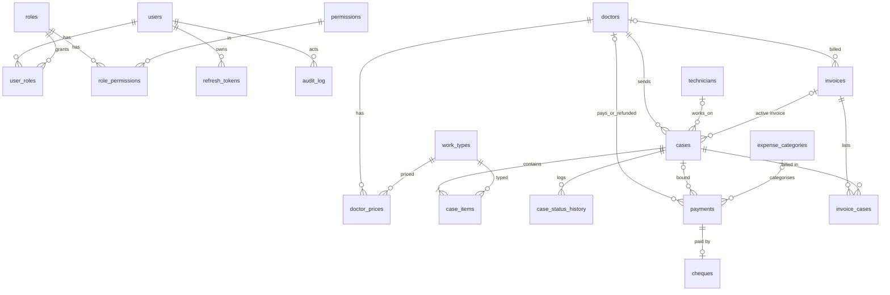

# 00 — Phase 0 Assessment

> Status: **approved by the owner (2026-11-06)**, including the deviations in §2.2 · Date: 2026-11-06 · Scope: backend (Phase 1, B0–B8) only.
> Binding inputs: `CLAUDE.md`, `ENGINEERING_STANDARDS.md`, `SPEC.md`, `.claude/skills/*`.
> Product name is still `PRODUCT_NAME` (placeholder, one constant).

---

## 1. Current state of the repository

The repository is **nearly empty**. There is no application code, no `package.json`, no database and no CI yet.

| Path | Content |
|---|---|
| `CLAUDE.md`, `ENGINEERING_STANDARDS.md`, `SPEC.md`, `README.md` | Brief, standards, specification |
| `.claude/skills/` | 4 project skills: feature-workflow, money-ledger, db-migrations, security-review |
| `assets/` | Smile Artec logos (PNG, transparent) + `fonts/Cairo.ttf` (OFL) |
| `docs/reference/invoice-sample.{html,pdf,png}` | Approved starting look of the printed invoice (Phase 2) |
| `.gitignore` | Node/env/backup ignores |

Git: one commit (`chore: initial brief, spec and standards`) on `main`.
Consequence: no existing behaviour to preserve; every structural choice below is new and recorded as an ADR in `docs/adr/`.

---

## 2. Decisions

### 2.1 Confirmed by the owner (2026-11-06)
| # | Topic | Decision | SPEC ref |
|---|---|---|---|
| 1 | Currency | **₪ (ILS), 2 decimals**. Single currency; locked once financial data exists | §5.18, §12.6 |
| 2 | VAT | **No tax** on invoices in v1 | §12.13 |
| 3 | Dues | Case price counts toward the doctor's debt **from case creation** | §7.3, §12.4 |
| 4 | Cheques | Incoming/outgoing cheque counts **only when `cleared`** | §7.4, §12.5 |
| 5 | Product name | **Not decided** — placeholder via one `PRODUCT_NAME` constant (ideas in §11) | §2.3, §12.19 |
| 6 | Arabic lab name | **«مختبر سمايل آرتك لتقنية الأسنان»** — value of the owner installation's lab-profile setting, not code | §1, §12.9 |
| 7 | Numbering start | **Owner chooses the first number** for cases and invoices (one-time setting) | §7.7, §12.12 |
| 8 | Old data | **No import** — start fresh; each doctor's existing debt is entered as an opening balance | §5.2 |

Previously decided in SPEC: NestJS + PostgreSQL; Windows installer; one independent install per customer; one `owner` role, RBAC-ready; invoice PDF rendered in Phase 2 from snapshot + template JSON.

### 2.2 Deviations from SPEC (small, justified — please confirm)
1. **Numbering start (owner answer 7).** `counters` table holds `case_no` and `invoice_no` next values. The start value is settable in Settings/first-run **only while no case / invoice exists**; after that it is locked. Payment numbers `IN-`/`OUT-` start at 1.
2. **Audit log text is rendered, not stored.** SPEC §8 has `summary_ar`; §6.1 forbids frozen Arabic text. `audit_log` stores `action` code + `params` JSON + `user_id`; «آخر العمليات» is rendered per language on read.
3. **Invoice void keeps history.** SPEC §8 says voiding deletes `invoice_cases` rows. We **keep** them (never delete financial records) and only clear `cases.invoice_id`. "Case is on an active invoice" = `cases.invoice_id IS NOT NULL`.
4. **"Backup on app close"** (§5.18) does not fit a background service. Replaced by: daily scheduled backup + backup on service stop + mandatory pre-upgrade backup (§2.1 already asks for these). Keep last 10.
5. **Restore** validates a PostgreSQL dump (not "a DB file"): checks `schema_meta.db_marker` + schema version before swapping.
6. **"Today"** is computed in the lab's time zone — a setting whose initial value is read from Windows at install time — not the server's UTC clock.

---

## 3. Architecture

**Modular monolith**, one NestJS process, one PostgreSQL database (ADR-0001).

```
apps/api/
  src/
    main.ts                      bootstrap: config check, helmet, CORS, pino, filters, swagger, shutdown hooks
    app.module.ts
    config/                      env schema (zod) → typed AppConfig, PRODUCT_NAME constant
    shared/
      money/                     parse/format/round half-up, integer minor units (pure)
      i18n/                      catalogs ar.json / en.json, translator, Accept-Language resolver
      errors/                    DomainError(code, params), global exception filter, error envelope
      db/                        drizzle client, schema, transaction helper, migrator
      audit/                     AuditWriter (inside caller's transaction)
      numbering/                 nextNumber(tx, counter) with row lock
      idempotency/               key + request-hash check
      pagination/, http/         query DTOs, correlation id middleware
    modules/<module>/
      domain/                    entities/value objects/pure rules — no Nest, no DB
      application/               use-case services; one transaction per write
      infrastructure/            drizzle repositories, readers
      presentation/              controllers, request/response DTOs, OpenAPI
  test/{unit,integration,e2e}
  migrations/                    generated SQL, reviewed and committed
```

Rules: controllers only map DTO ↔ use case; domain has no framework imports; responses are DTOs built by mappers (no DB rows leak); every write = validated DTO → application service → one DB transaction (+ audit row in that transaction).

---

## 4. Module boundaries

| Module | Responsibility | Depends on |
|---|---|---|
| `shared` | money, i18n, errors, db/tx, audit, numbering, idempotency, pagination | — |
| `identity` | first-run setup (self-locking), login/logout/refresh, change own password, users/roles/permissions, guards | shared |
| `settings` | lab profile (name AR/EN, phone, address, logo ref), currency (locked after data), UI + document language, time zone, invoice template JSON, numbering start | shared |
| `catalog` | technicians, work types (+ seed), expense categories (+ seed) | shared |
| `doctors` | doctors CRUD/inactivate, special prices | shared, catalog |
| `ledger` | **pure** `allocate()` and `doctorBalance()` + read queries: balances, debts, breakdown, statement | shared |
| `cases` | create/edit/cancel, items, price resolution, status machine + history, delivery flow, `collect_on` | shared, catalog, doctors, ledger, payments (application API) |
| `payments` | incoming/outgoing, void, cheques + status transitions, idempotency | shared, doctors, catalog, ledger, `CaseReader` port |
| `invoices` | cases / statement / free invoices, immutable snapshot, void | shared, settings, doctors, cases (reader), ledger |
| `reporting` | dashboard, receipts/expenses reports, CSV export, global search, notifications feed + dismissals, recent operations | shared, ledger (read side) |
| `backup` | backup now / list / restore / schedule status | shared, settings |
| `health` | `/health/live`, `/health/ready` (DB reachable, migrations current) | shared |

**No cycles:** `cases` calls `PaymentsService.createIncoming(tx, …)` for advance/delivery payments inside its own transaction. `payments` only needs to check "case belongs to this doctor and is not cancelled", through a `CaseReader` interface defined in `payments` and implemented in `cases/infrastructure` — dependency inversion, no import back into `cases` application code.

Every user-facing string (errors, statuses, notifications, CSV headers, audit summaries, seed names) lives in `ar.json`/`en.json`; the API returns stable codes + params + a localized `message`.

---

## 5. Data model (PostgreSQL)

Conventions (ADR-0003, skill *db-migrations*): `snake_case`; `BIGINT GENERATED ALWAYS AS IDENTITY` PKs; money `BIGINT` minor units (JS side guarded by `Number.isSafeInteger`); business dates `DATE`; events `timestamptz`; case-insensitive uniqueness via unique index on `lower(name)`; explicit `NOT NULL`; `CHECK` constraints; FKs `ON DELETE RESTRICT` (financial history never cascades); `row_version INT` on mutable aggregates; `created_at/by`, `updated_at/by`.



### 5.1 Tables (summary — exact DDL comes with each milestone's migration)
| Table | Key columns / constraints |
|---|---|
| `schema_meta` | `key`, `value` — `db_marker` (random UUID per install + product marker), `schema_version` |
| `settings` | `key` PK, `value jsonb`, `row_version`, `updated_at/by` |
| `counters` | `name` PK (`case_no`,`invoice_no`,`payment_in`,`payment_out`), `next_value BIGINT CHECK (>0)` |
| `users` | `username` unique (lower), `password_hash`, `active`, `must_change_password`, `failed_logins`, `locked_until` |
| `roles`, `permissions`, `role_permissions`, `user_roles` | RBAC; seed: role `owner` ← all permissions |
| `refresh_tokens` | `token_hash` unique, `family_id`, `user_id`, `expires_at`, `revoked_at`, `replaced_by` |
| `doctors` | `name` unique (lower), phone, clinic, notes, `opening_balance BIGINT` (signed), `active`, `row_version` |
| `technicians` | `name` unique (lower), `active` |
| `work_types` | `name` unique (lower), `unit_price BIGINT CHECK ≥0`, `sort_order`, `active`, `row_version` |
| `doctor_prices` | PK (`doctor_id`,`work_type_id`), `price CHECK ≥0` |
| `cases` | `case_no` unique, `doctor_id`, `patient_name`, `technician_id?`, `received_date`, `expected_date CHECK ≥ received_date`, `delivered_date?`, `collect_on?`, `status CHECK IN (waiting,design,in_progress,ready,delivered,returned,cancelled)`, `discount CHECK ≥0`, `total` (cached, recomputed in tx), `invoice_id?`, `notes`, `row_version` |
| `case_items` | `case_id`, `tooth_no CHECK FDI 11–48 / units 1–8`, `work_type_id`, `work_type_name` (snapshot), `shade?`, `unit_price CHECK ≥0` (snapshot), `price_source CHECK IN (general,special,manual)` |
| `case_status_history` | `case_id`, `from_status?`, `to_status`, `at`, `note`, `user_id` |
| `expense_categories` | `name` unique (lower), `is_doctor`, `active` |
| `payments` | `no` unique, `direction CHECK IN (in,out)`, `doctor_id?`, `case_id?`, `category_id?`, `payee?`, `amount CHECK >0`, `method CHECK IN (cash,cheque)`, `paid_date`, `note`, `status CHECK IN (active,void)`, `void_reason`, `voided_at/by`, `idempotency_key` unique nullable, `request_hash`; CHECKs: `in` ⇒ doctor required; `out` ⇒ category required; void ⇒ reason present |
| `cheques` | `payment_id` unique, `cheque_no`, `bank`, `due_date`, `status CHECK IN (pending,cleared,returned,void)`, `status_date` |
| `invoices` | `no` unique, `type CHECK IN (cases,statement,free)`, `doctor_id?`, `party_name?`, `issue_date`, `period_from/to?`, `reason?`, `subtotal`, `discount`, `total`, `language`, `status`, void fields, `snapshot jsonb NOT NULL`, idempotency fields |
| `invoice_cases` | PK (`invoice_id`,`case_id`) — kept after void (deviation 3) |
| `dismissed_notifications` | PK (`user_id`,`notification_key`), `at` |
| `audit_log` | `at`, `user_id`, `action` (e.g. `payment.void`), `entity`, `entity_id`, `params jsonb` (no secrets, no patient data beyond what the screen shows) |

Planned indexes follow real queries (SPEC §8 list + `payments(case_id)`, `cheques(status, due_date)`, `cases(collect_on) WHERE collect_on IS NOT NULL`, `invoices(doctor_id, issue_date)`, `audit_log(at DESC)`), checked with `EXPLAIN` against a 20k cases / 50k payments seed in B8.

### 5.2 Invoice snapshot (supports `docs/reference/invoice-sample.html`)
`{ version, language, currency {code, symbol, decimals}, lab {name_ar, name_en, phone, address, logo_ref}, invoice {no, type, issue_date, period}, party {doctor_id?, name, clinic, phone}, lines [{case_no, patient, teeth[], work_type, shade, qty, unit_price, total}], subtotal, discount, total, balances {previous, current}, notes, footer_text }` — lines grouped by case + work type + shade + unit price. Template JSON (colours, font size, columns, toggles) is stored separately and only styles the render.

---

## 6. API outline (`/api/v1`, OpenAPI at `/api/docs` in dev)

| Area | Endpoints |
|---|---|
| Setup / auth | `GET /setup/status`, `POST /setup` (locks after first use), `POST /auth/login`, `POST /auth/refresh`, `POST /auth/logout`, `POST /auth/change-password`, `GET /auth/me` |
| Settings | `GET/PATCH /settings/lab-profile`, `/settings/currency`, `/settings/language`, `/settings/numbering`, `GET/PUT /settings/invoice-template` |
| Catalog | `/technicians`, `/work-types`, `/expense-categories` (list, create, patch, delete→deactivate if used) |
| Doctors | `/doctors` (list+search, create, get, patch, activate/deactivate), `GET/PUT /doctors/{id}/prices`, `GET /doctors/{id}/account`, `GET /doctors/{id}/statement?from&to` |
| Cases | `/cases` (list with status/doctor/overdue filters, create, get, patch), `POST /cases/{id}/status`, `POST /cases/{id}/deliver`, `POST /cases/{id}/cancel`, `GET /cases/uninvoiced?doctorId` |
| Payments | `POST /payments/incoming`, `POST /payments/outgoing` (both `Idempotency-Key`), `GET /payments`, `GET /payments/{id}`, `POST /payments/{id}/void` |
| Cheques | `GET /cheques`, `POST /cheques/{id}/status` |
| Debts | `GET /debts`, `GET /debts/{doctorId}` (breakdown) |
| Invoices | `POST /invoices` (`Idempotency-Key`), `GET /invoices`, `GET /invoices/{id}` (snapshot + template), `POST /invoices/{id}/void` |
| Reports | `GET /reports/receipts`, `/reports/expenses`, `/reports/cash-summary`; every list `?format=csv` (UTF-8 BOM) |
| Read side | `GET /dashboard`, `GET /search?q=`, `GET /notifications`, `POST /notifications/{key}/dismiss`, `GET /activity` |
| Backup | `GET /backups`, `POST /backups`, `POST /backups/restore`, `GET /backups/status` |
| Health | `GET /health/live`, `GET /health/ready` |

Conventions: error envelope `{ error: { code, message, params, correlationId } }`; pagination `?page&pageSize` (default 25, max 100) → `{ items, page, pageSize, total }`; updates of mutable aggregates carry `rowVersion` → `409 error.concurrency.stale`; idempotent replay with same key + same body returns the original result, same key + different body → `422 error.idempotency.mismatch`; money in/out as integer minor units plus the currency block.

---

## 7. Threat model (STRIDE-light)

Assets: financial ledger, doctor/patient names, owner credentials, backups, DB password.
Trust boundary: the API process; the client (later the browser UI) is untrusted.

| Threat | Mitigation |
|---|---|
| Someone on the LAN reaches the API | Bind to `127.0.0.1` only (owner: one computer per install, §11 Q1) |
| Taking over first-run setup | `POST /setup` works only while no user exists; atomic check inside a transaction; rate-limited |
| Password guessing | Argon2id; throttle `/auth/login`; progressive lockout per user; generic error message |
| Token theft / replay | 15-min JWT access token; refresh tokens random, stored **hashed**, rotated each use, reuse ⇒ whole family revoked; logout revokes |
| Mass assignment / tampering | DTO whitelist + `forbidNonWhitelisted`; server computes every price, total, balance, number; client totals only compared, never stored |
| Double payment / double invoice | `Idempotency-Key` unique constraint; one transaction per write |
| Lost updates / race on balances | `row_version` optimistic locking; `SELECT … FOR UPDATE` on the doctor row for payment/invoice/case writes; counters row-locked |
| Silent changes to money history | No DELETE paths on payments/cheques/invoices; void with reason + audit; FK `RESTRICT`; invoices immutable |
| Injection | Parameterised queries only (Drizzle); no string-built SQL |
| Information leakage | Global filter → codes only, no stack/SQL/paths; pino redaction of auth headers, passwords, tokens; patient names never logged |
| DB password exposure | Random per install, stored in a config file readable only by the service account (Windows ACL); never in repo |
| Backup theft | Backup folder ACL; no encryption in v1 (owner decision, §11 Q2) — accepted risk, revisit before production |
| Vulnerable dependencies | `npm audit` + lockfile in CI; minimal dependency list |
| Logo upload abuse (B1) | PNG/JPEG only (no SVG in v1), checked by magic bytes, size limit, stored outside web root with generated name |

---

## 8. Test strategy

| Level | Tooling | What |
|---|---|---|
| Unit | Jest | money (parse/format/round, 0/2/3 decimals), `allocate`, `doctorBalance` (full matrix of the money-ledger skill), status machine, price resolution, numbering format, i18n translator |
| Integration | Jest + Testcontainers (PostgreSQL 16) | migrations on empty DB and on previous schema with data; constraints; repositories; numbering gap-free under concurrency; idempotency replay; `row_version` 409; concurrent payments on one doctor |
| E2E (API) | Supertest on the full Nest app + Testcontainers | setup → login → doctor → case → payment → invoice → void; auth/authorization negatives (401/403) on every route; validation negatives; error messages in `ar` and `en` |
| Static | ESLint, `tsc --noEmit`, i18n key-parity script | catalogs identical keys |
| CI | GitHub Actions (ubuntu, Docker available) | lint · typecheck · unit · integration · e2e · build · `npm audit --audit-level=high` |

Coverage goals: `shared/money` and `ledger/domain` ≈ 100% branches; overall meaningful coverage, not a vanity number. Results reported only from real runs.

---

## 9. Deployment, backup and upgrade

**Development:** Docker Compose (PostgreSQL 16 only); API runs with `npm run dev`.

**Production = Windows installer** (ADR-0011, ADR-0012):
- **Installer:** Inno Setup (free, scriptable, supports upgrade detection and custom pages). Output name built from `PRODUCT_NAME`.
- **Runtime:** official `node.exe` (LTS) + compiled API `dist/` + production `node_modules` (only prebuilt Windows binaries such as `@node-rs/argon2`).
- **Database:** PostgreSQL 16 portable binaries (EDB zip, PostgreSQL licence permits redistribution); `initdb` into `%ProgramData%\<PRODUCT_NAME>\data`, listen on `127.0.0.1` on a private port, random superuser + app user passwords generated at install.
- **Services:** both registered with WinSW (MIT) — auto-start, restart on failure, API depends on DB.
- **First run:** installer starts services → API runs migrations → owner opens `http://localhost:<port>` → setup.
- **Backups:** `pg_dump -Fc` daily + on service stop + before every upgrade into the owner-chosen folder; keep last 10; status visible via API.
- **Restore:** `pg_restore` into a temporary DB → check `schema_meta` marker + version ≤ current → pre-restore backup of the current DB → swap → restart API.
- **Upgrade:** stop API → backup → replace binaries → migrate → start; on failure restore the pre-upgrade backup and the previous binaries.
- **Uninstall:** removes program files and services; data and backups kept unless the owner ticks "delete my data".
- Offline, no telemetry, rotated logs in `%ProgramData%\<PRODUCT_NAME>\logs`.

---

## 10. Milestones

| # | Content | Done when |
|---|---|---|
| **B0** | Monorepo skeleton (`apps/api`), env config + validation, `PRODUCT_NAME` constant, Drizzle + first migration (identity, settings, counters, audit, schema_meta), Docker Compose, CI, health, pino + correlation id, error filter + envelope, i18n service + parity check, OpenAPI, setup/login/refresh/logout/change-password, audit writer | Pipeline green, empty DB boots, login works |
| B1 | Doctors, technicians, work types (+ seed), special prices, expense categories (+ seed), settings (lab profile, currency, numbering start, language, logo) | CRUD + validation + tests |
| B2 | Cases, items, price resolution, status machine + history, numbering | Rules of §5.3/§5.6/§9 enforced |
| B3 | Payments in/out/void, cheques, idempotency, `allocate`, `doctorBalance` | Exhaustive unit tests tie to hand calculations |
| B4 | Debts + breakdown, statement, receipts/expenses reports, CSV, search | Breakdown ties to ledger |
| B5 | Delivery flow, cheque status transitions, notifications | §7.4 verified |
| B6 | Invoices (3 types), snapshot, void, template storage | Snapshot unchanged after later edits |
| B7 | Windows installer, services, upgrade/rollback, backups, tested restore | Clean Windows VM: install → use → upgrade → restore |
| B8 | Security review, index/query review, concurrency tests, frozen OpenAPI | Owner sign-off of backend |

---

## 11. Follow-up questions — answered 2026-11-06

1. **Computers:** **one computer per installation**; the API listens on `127.0.0.1` only. LAN sharing stays a pre-production item.
2. **Backup encryption:** **not in v1** (folder ACL only); listed in `production-readiness.md`.
3. **Time zone:** a setting whose initial value is **taken from Windows during installation** (dev/CI: from config, fallback `UTC`).
4. **Product name:** **postponed**; the `PRODUCT_NAME` placeholder stays. Ideas for later (check trademark/domain first): «مختبري / Mukhtabari», «LabLedger», «DentFlow Lab», «Sinn Lab (سِنّ)».
