# F2b — Home, case-list actions, column alignment

Screens of the `feat/f2b-home` slice at 1440 × 1000 (the mockup's size), real API and database.
Home with data and the case screens come from a preview installation with sample names; the empty
Home comes from the first-run E2E installation. Reference: the approved direction A mockup,
[`docs/design-directions/a-brand-gradient.html`](../../design-directions/a-brand-gradient.html).

## Home next to the mockup

| Direction A mockup | This slice (Arabic, with logo) |
|---|---|
| 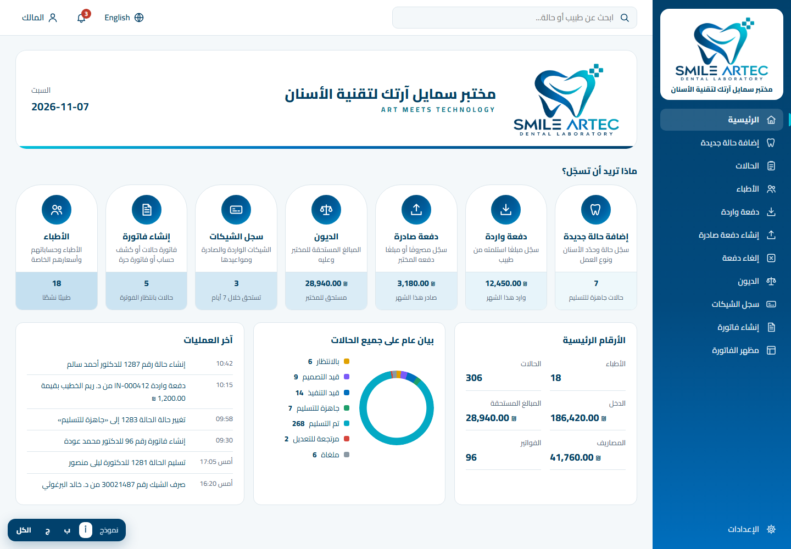 | 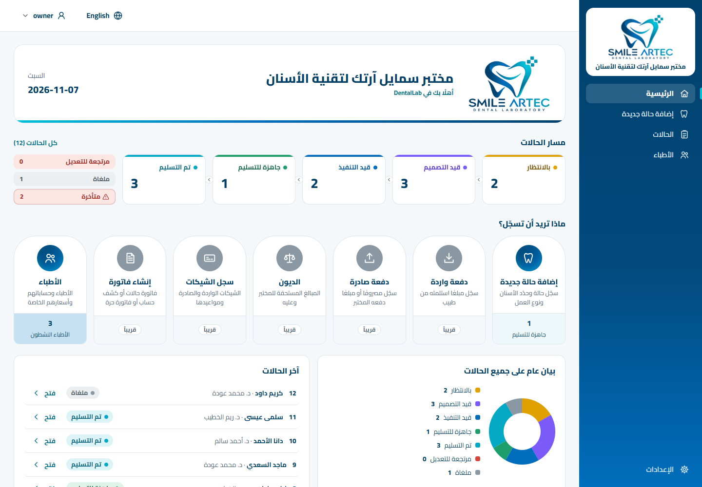 |

| English, with logo | Arabic, no logo (name only) | English, no logo |
|---|---|---|
| 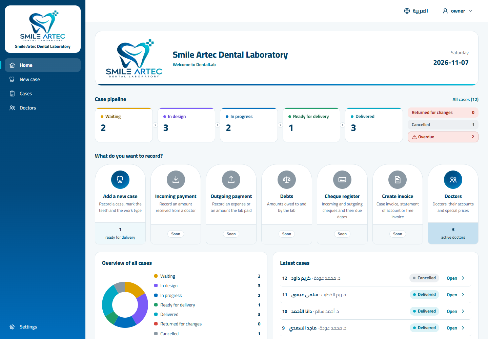 | 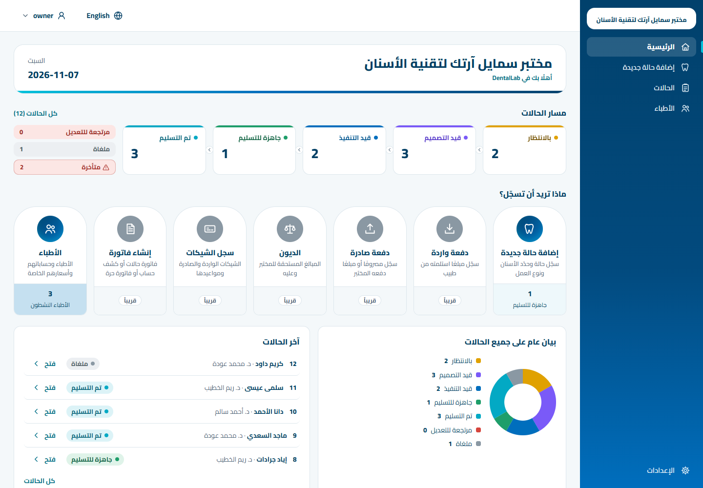 | 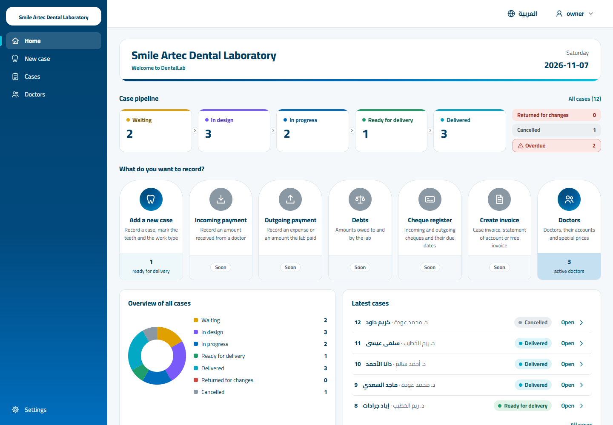 |

| Empty installation (Arabic) | Empty installation (English) |
|---|---|
| 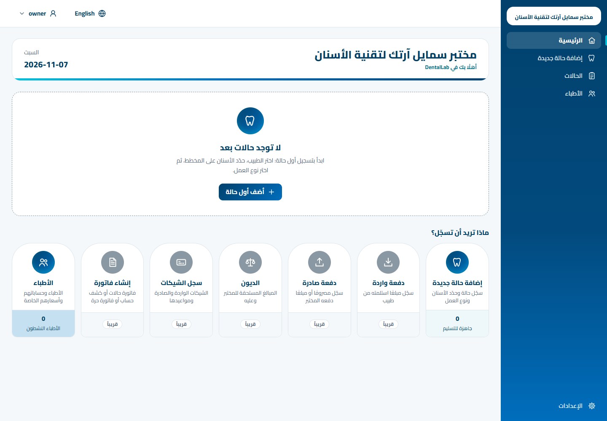 | 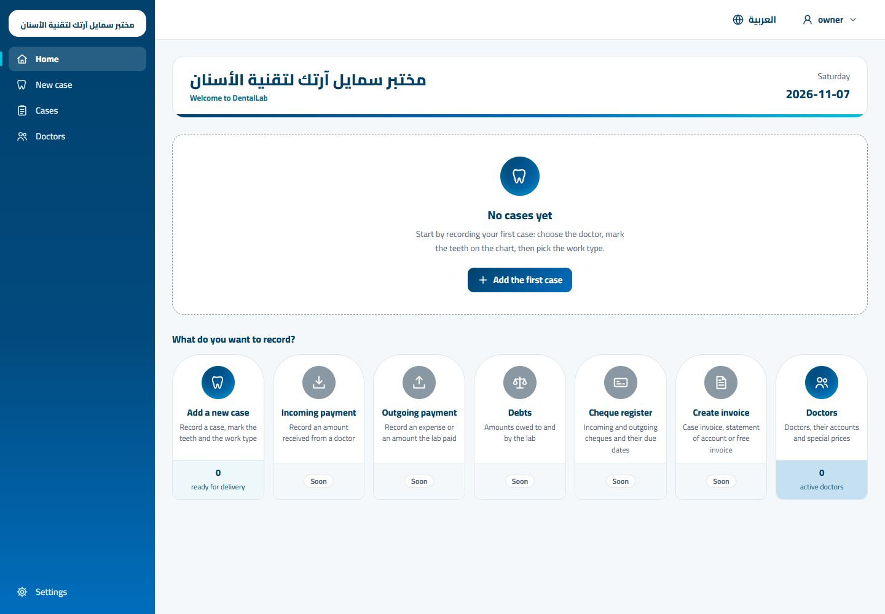 |

### Visible differences from the mockup

Kept because real data, the scope (SPEC §3.1, no dead features §3.2) or accessibility require them:

1. **Top bar** — no search box and no notification bell (global search ships with B4; there is no
   notifications feature). The user chip shows the signed-in username, not a fixed «المالك».
2. **Sidebar** — only screens that work today (Home, New case, Cases, Doctors, Settings), not the
   mockup's eleven items. The others appear with their slices.
3. **Banner tagline** — «أهلًا بك في DentalLab» (product name constant) instead of Smile Artec's
   «ART MEETS TECHNOLOGY»: nothing lab-specific is hard-coded, and Arabic is never letter-spaced.
4. **Banner without a logo** — name only, so the banner is shorter (the mockup always has a logo).
5. **Case pipeline** — added between the banner and the cards (direction C's strip, requested for
   this slice), drawn in A's language: white cards, 14 px radius, a 4 px top rule in the status
   colour, chevrons between stages; returned, cancelled and overdue beside them.
6. **Action-card figures** — only «إضافة حالة جديدة» (cases ready for delivery) and «الأطباء»
   (active doctors) have live figures and are links. The five others show a «قريباً» badge, a grey
   knob and no hover lift, because their features do not exist yet.
7. **Figure labels on the bands** — dark ink instead of the mockup's grey: grey on the darkest band
   (doctors) fails WCAG AA contrast (axe).
8. **Bottom row** — two panels (status donut, latest cases) instead of three. «الأرقام الرئيسية»
   (income, debts, expenses, invoices) needs the money slices (B3–B6); «آخر العمليات» (an activity
   feed of every kind) becomes «آخر الحالات», since cases are the only records so far, with the
   status badge and an «فتح» button per row (owner feedback on opening cases).
9. **Numbers** — every count is live from `GET /cases/summary`; the mockup's sample numbers differ.
10. **Mockup chrome** — the «نموذج أ ب ج الكل» switcher at the bottom belongs to the mockup only.

Fixed during the comparison (they were not required by data or accessibility):

- The donut first had the total written in its centre; the mockup's ring is empty, so the centre is
  empty again (the total stays in the donut's accessible name and the pipeline header).
- The banner's bottom rule runs navy → cyan from the reading start, as in the mockup, in both
  languages (checked against the mockup's computed gradient).
- The sidebar lab name is 12.5 px, the page gutter 28 px and the banner top margin 18 px, as in
  the mockup.

## Case list: action column and row menu

| Arabic | English |
|---|---|
| 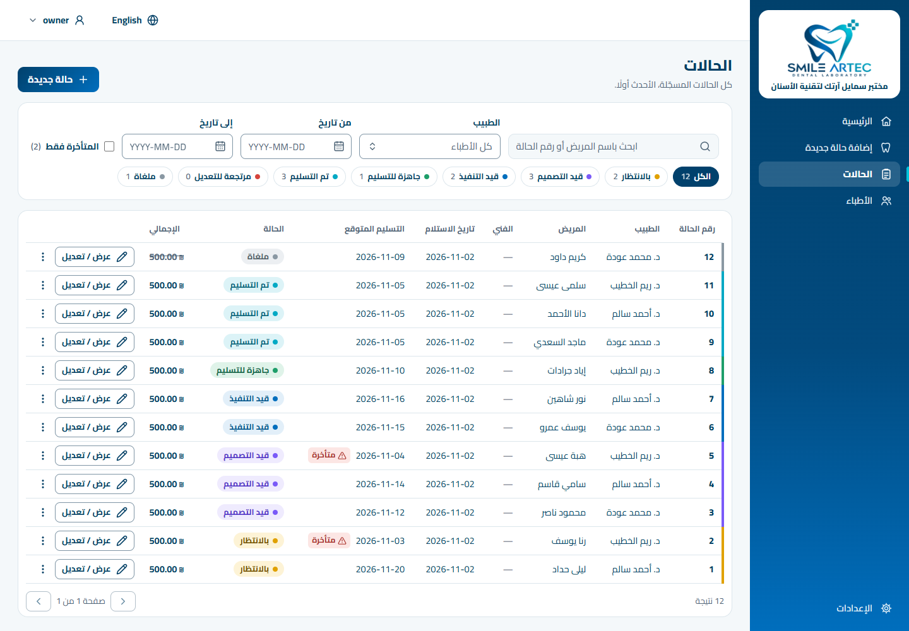 | 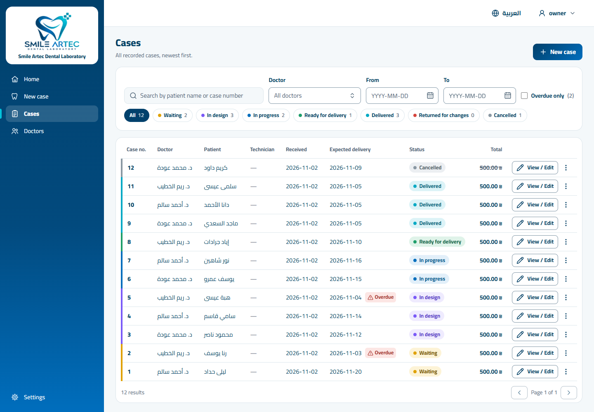 |
| 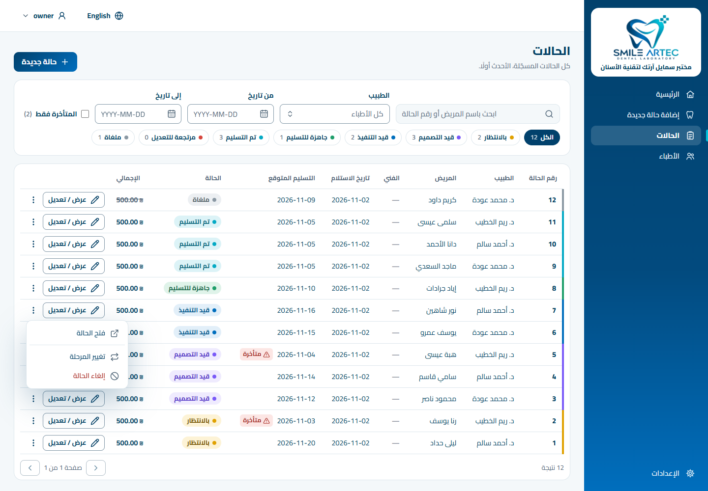 |  |

Every row: the case number is a link, a labelled «عرض / تعديل» button with an icon, and a «⋮» menu
that lists only what the API allows for that case (read when the menu opens). The whole row opens
the case on click. Status chips and «المتأخرة فقط» carry counts from `GET /cases/summary`.

## Case details header

| Arabic | English |
|---|---|
| 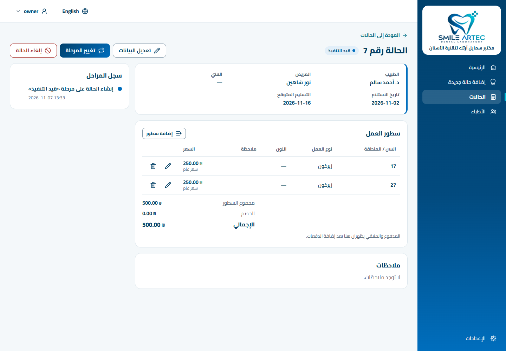 | 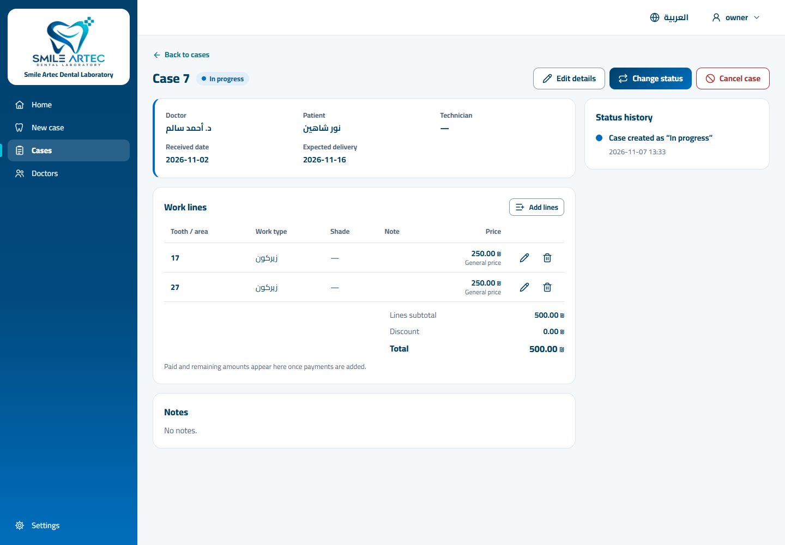 |

Edit, change status and cancel are always in the header; an action the API does not allow stays
visible, disabled, with the reason as a tooltip and as its accessible description.

## Column alignment (doctors list)

| Arabic | English |
|---|---|
| 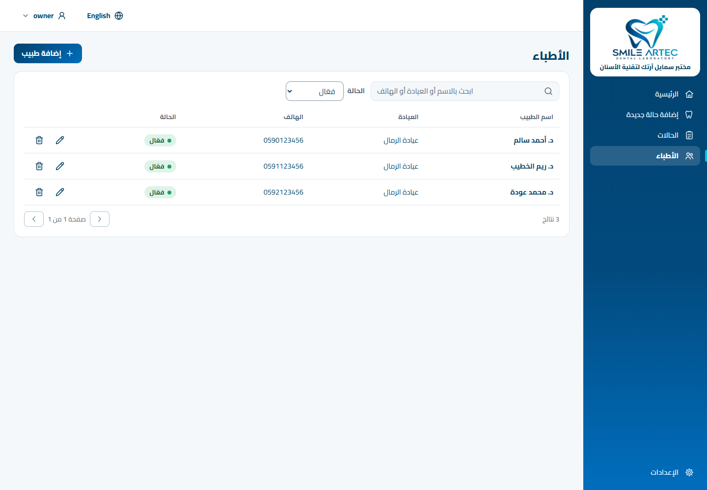 | 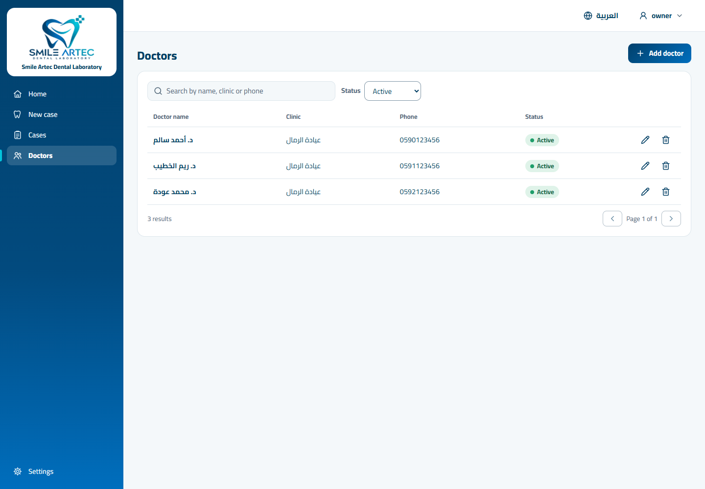 |

Each value sits under its header: names, phones, case numbers and dates at the reading start,
amounts at the reading end, row actions at the end. E2E checks the edges in both languages.
