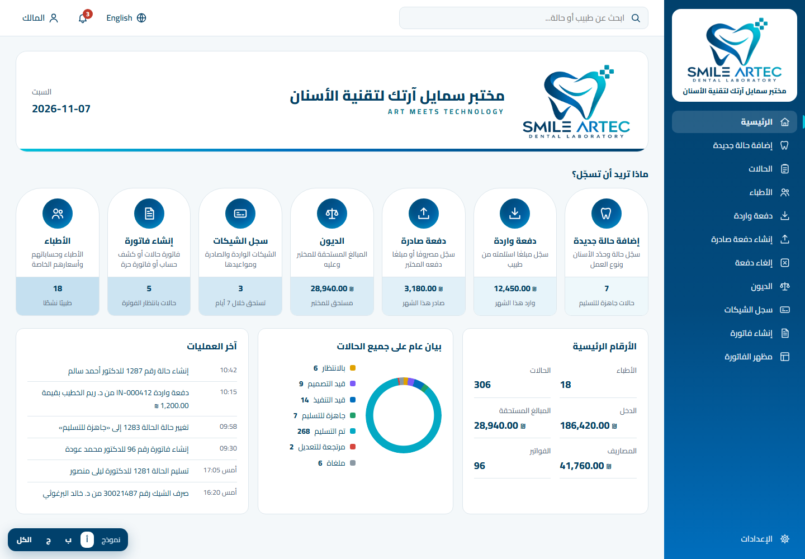
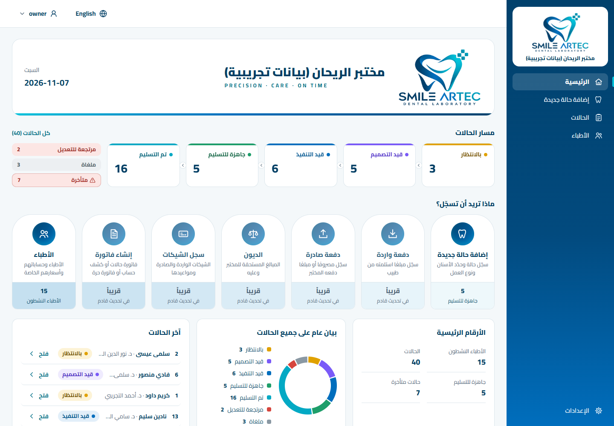
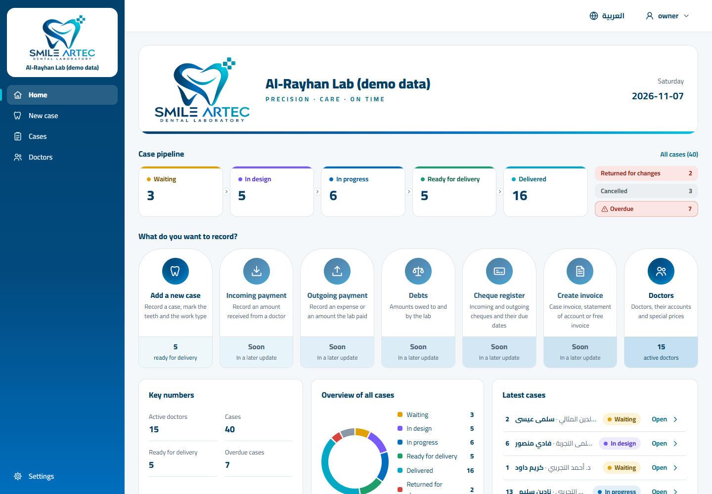
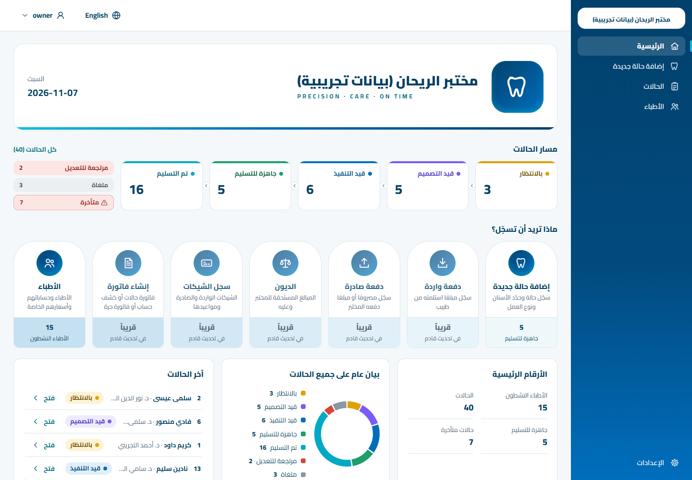
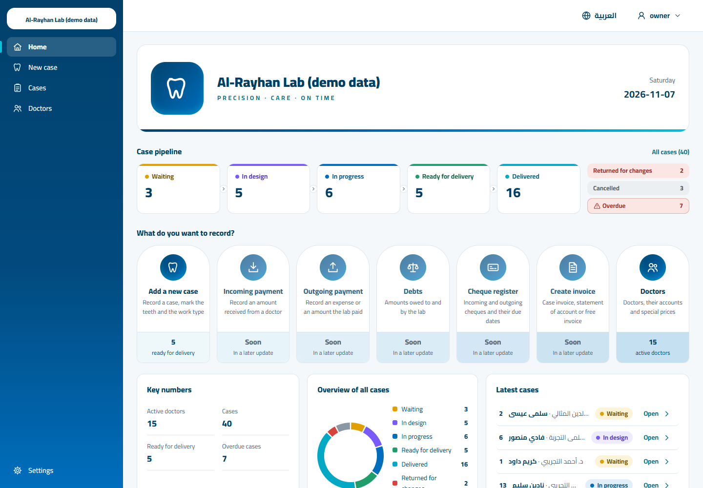
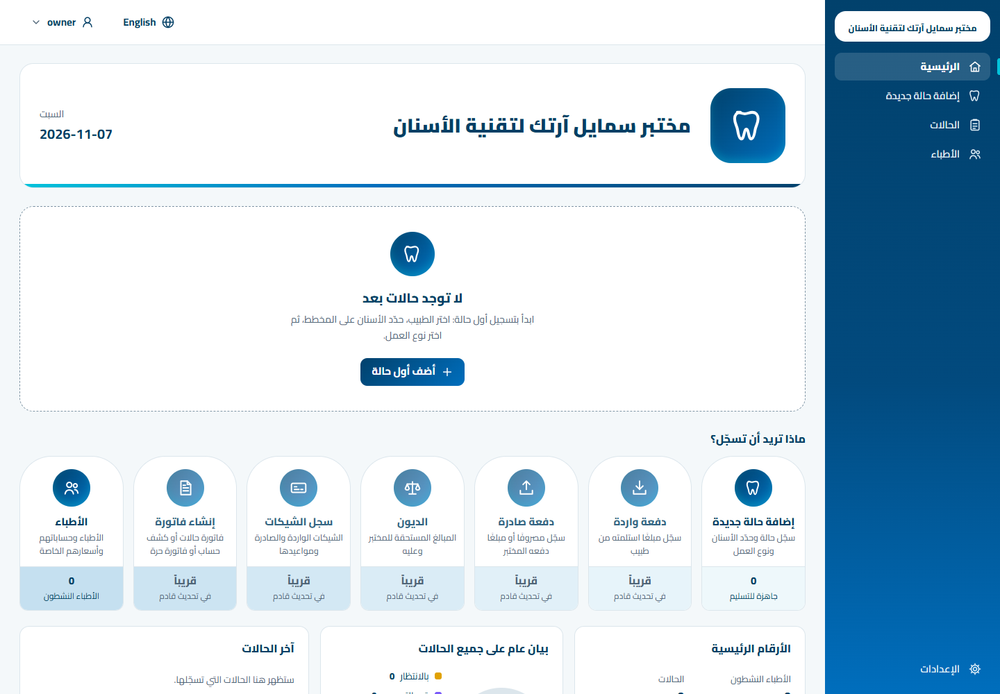
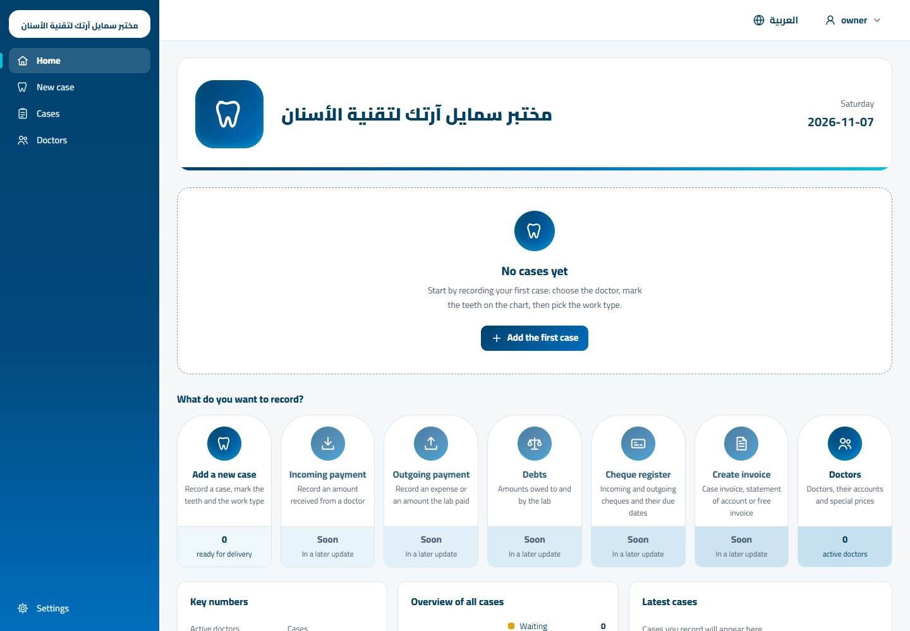
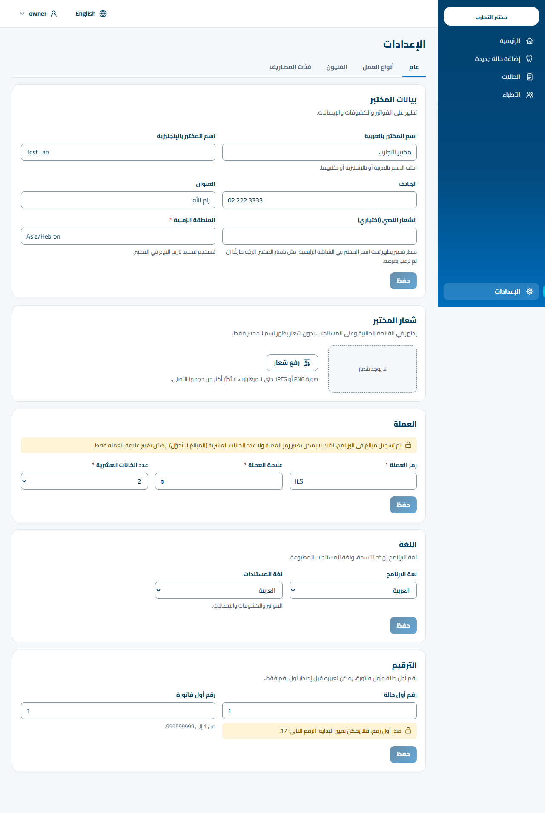
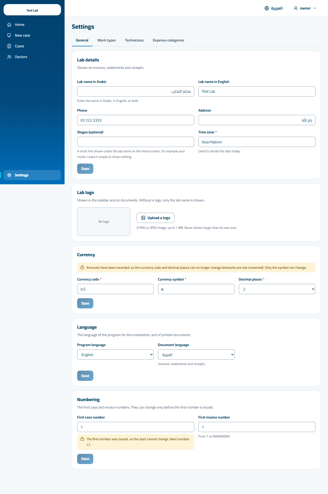

# F2c — Home polish next to direction A

Screens of the `feat/f2c-home-polish` slice at 1440 × 1000 (the mockup's size), taken by the
Playwright specs (`E2E_SHOTS_DIR`) on the real API and database. "Demo data" is the fictional
data of `npm run seed:demo` / `npm run demo` (15 doctors, 8 work types, 3 technicians, 40 cases);
"empty" is the first-run installation. Reference: the approved mockup
[`docs/design-directions/a-brand-gradient.html`](../../design-directions/a-brand-gradient.html).

## Home with demo data and a logo, next to the mockup

| Direction A mockup | This slice (Arabic, demo data, logo) |
|---|---|
|  |  |

| English, demo data, logo | Arabic, demo data, no logo | English, demo data, no logo |
|---|---|---|
|  |  |  |

Full-page captures (bottom row included): [Arabic](home-demo-ar-full.png) · [English](home-demo-en-full.png).

## Home on an empty installation

| Arabic | English |
|---|---|
|  |  |

## Settings — the new slogan field

| Arabic | English |
|---|---|
|  |  |

## What changed (owner feedback)

1. **«قريباً» cards** — same language as the live cards: brand knob in a lighter tone (`knob-soon`),
   the figure band in its colour with «قريباً / في تحديث قادم». Still no link, no tab stop, no hover,
   `aria-disabled` (axe clean; the small text on the deepest band is 4.6 : 1).
2. **Banner** — lab name 28 px / 900; logo up to the mockup's 200 px width and never past its native
   size; without a logo a brand tile with the tooth mark holds its place; second line = the lab's
   slogan (new optional setting) or the name in the other language, Latin text in letter-spaced
   capitals like the mockup's «ART MEETS TECHNOLOGY»; date block as in the mockup (weekday muted,
   date 20 px bold); 180 px minimum height with or without a logo (E2E checks ±4 px); the
   navy → cyan rule underneath. The product name is no longer in the banner.
3. **Donut** — the mockup's ring is 14 px thick (its mask hole is 56 % of the distance to the box
   corner, not of the radius); ours was 30 px. Now 14 px, 2.5 px gaps between statuses, status
   colours unchanged, centre empty, legend beside the ring in the narrower middle panel.
4. **«الأرقام الرئيسية»** — the third panel, with live figures only: active doctors, cases, ready
   for delivery, overdue; each opens its list. The three panels show on an empty installation too
   (zeros, bare ring, a hint) and share one height.
5. **Details** — panel titles 16 px / 800 with 12 px below, panel padding 18 × 20 px, 14 px radius,
   no shadows, as in the mockup.

## Remaining differences from the mockup, and why

1. **Money figures** — «الدخل», «المبالغ المستحقة», «المصاريف», «الفواتير» in the key numbers and the
   amounts on the payment, debt, cheque and invoice cards wait for their slices (B3–B6, SPEC §3.2:
   no dead features). The panel has four figures instead of six, so it ends higher than its content
   area in the mockup.
2. **Key-number values sit under their labels** — in the mockup the `ltr` number drifts to the far
   (left) edge of its cell in Arabic; we keep each value under its label, as every other table
   and list does since F2b.
3. **Donut gaps** — the mockup's ring is continuous; the thin white gaps were asked for in the
   feedback and make small statuses easier to tell apart.
4. **Banner second line** — the mockup shows Smile Artec's motto; we show the lab's own slogan or its
   other-language name, never a hard-coded text. An Arabic slogan is not letter-spaced (Arabic is
   never letter-spaced).
5. **Banner without a logo** — a brand tile instead of the logo; the mockup always has a logo.
6. **Kept from F2b** — the case pipeline between the banner and the cards, «آخر الحالات» instead of an
   activity feed, dark ink figure labels on the bands (contrast), no search box or notification
   bell, only working screens in the sidebar (see [F2b](../f2b/README.md)).
7. **Sample numbers and names** — the mockup's numbers are invented; ours are live from the demo
   data, so the counts and the donut's proportions differ.
